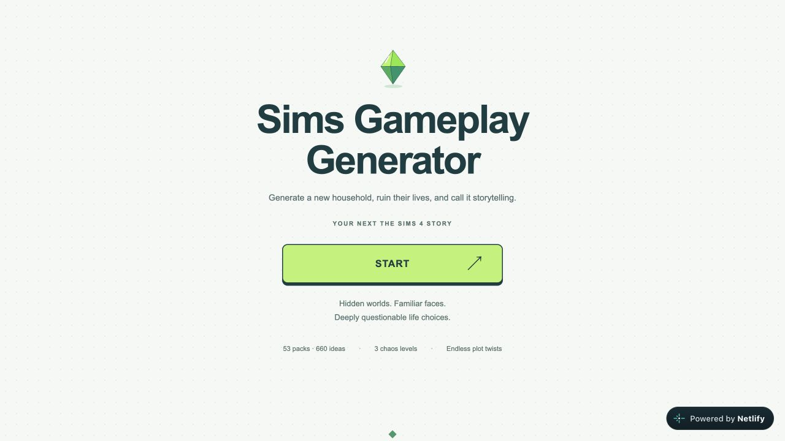
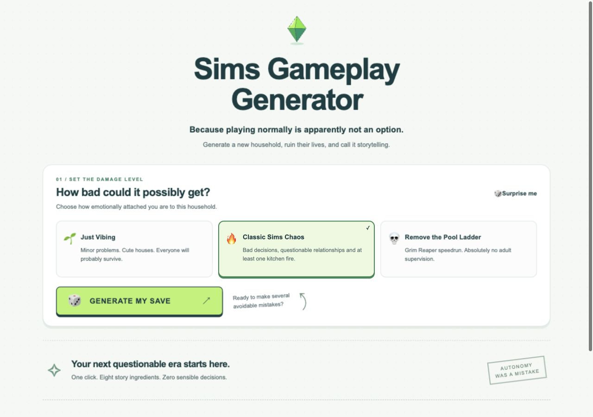
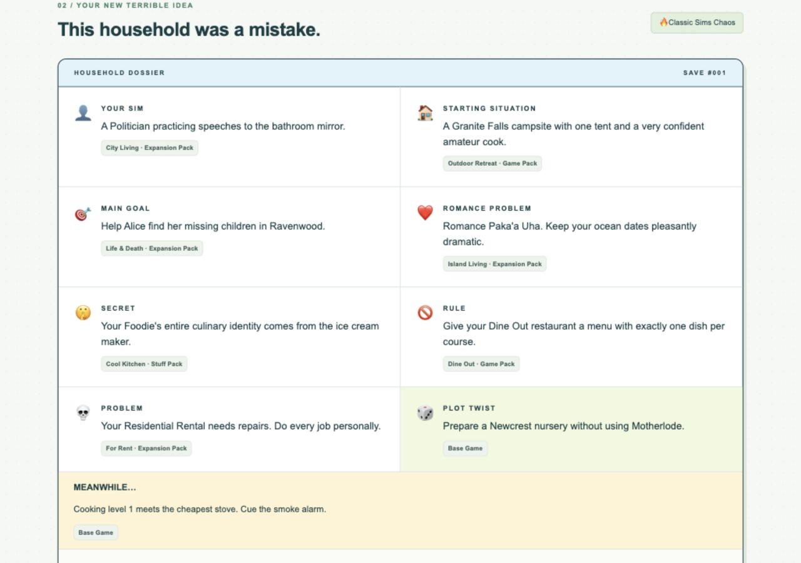
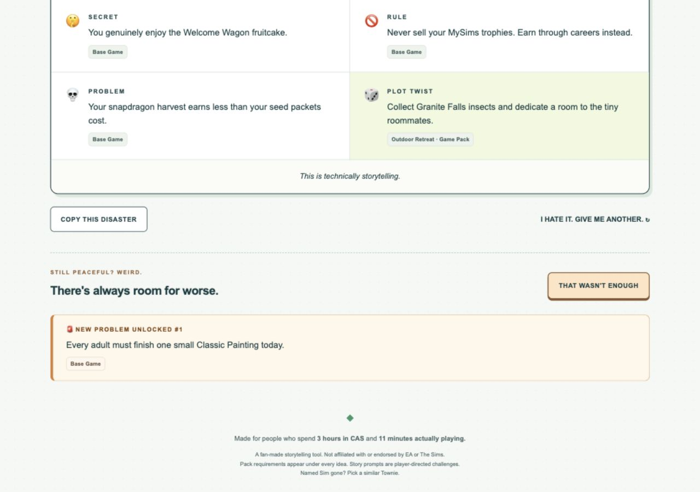

# Sims Gameplay Generator

This was made to help me generate cool storylines for my Sims.

[Sims gameplay generator](https://sims-gameplay-generator.netlify.app/)

## About the app

A gameplay generator for The Sims 4 with a welcome screen, three chaos levels, 660 prompts, and stackable disasters. Familiar Townies, skill challenges, basement painters, and no Motherlode.

Built with vanilla HTML, CSS, and JavaScript. No backend, accounts, or installation required.

## Start your next save

## Choose your chaos

## Meet your next terrible idea

## Make a bad situation worse

## Features

- Switch between English and Polish, including all 660 prompts, pack names, messages, and copied challenges. The language stays in this browser, and switching preserves your story and kept cards.

- Select owned packs, search the collection, or play with Base Game only. Selections stay in this browser.
- Keep any of the eight story cards and reroll the rest, without repeating their themes.
- Pack filters apply to stories, events, and extra disasters; cross-pack ideas require every listed pack.
- 278 new ideas covering 21 Expansion Packs, 12 Game Packs and 20 Stuff Packs.
- A concrete Sims 4 reference and pack label under every prompt.
- Three modes, from Just Vibing to Remove the Pool Ladder.
- Eight story ingredients, plus optional events and extra disasters.
- Shared theme tags prevent repeated objectives across a save and its disasters.
- When distinct disasters run out, start a new save instead of recycling old ones.
- Copy the entire challenge, including every added disaster.
- Responsive layout, keyboard support, and reduced-motion preferences.

## Run locally

Open `index.html` in a browser. No build step or dependencies.

## Deploy

Upload the project folder to Netlify, or import the repository with an empty build command and `.` as the publish directory. `netlify.toml` includes the configuration.

## Project structure

- `data.js` — prompt pools, difficulty tiers, themes, and pack requirements.
- `content-pl.js` — Polish prompts and game terminology, mapped by stable IDs.
- `i18n.js` — interface translations and language-aware formatting.
- `generator.js` — weighted selection and repeat prevention.
- `script.js` — page interactions and clipboard support.
- `styles.css` and `index.html` — the interface.
- `tests/` — generation and regression tests.
- `docs/screenshots/` — actual app screenshots.

Run tests with `node --test tests/generator.test.cjs`.

Some ideas require packs, listed beneath each prompt and included in copied challenges. Kits and Marketplace content are outside this catalogue. See [content notes and official sources](docs/CONTENT-SOURCES.md). If a named Sim is unavailable, choose a similar Townie. Shared themes are curated metadata rather than a complete simulation of every possible game state.

This project is not endorsed by or affiliated with EA or its licensors. The Sims and related names and marks belong to their respective owners. References identify the game and its packs; no ownership of those names, characters, or marks is claimed. See [EA’s content policy](https://help.ea.com/en/articles/security-and-rules/ea-content-policy/).
